# NYXI Flexi for Omarchy


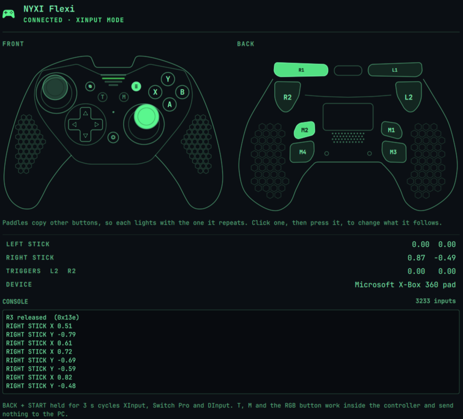


An Omarchy bar widget for the NYXI Flexi controller. Click the gamepad icon to open a popup with:

- **A QR code to the manual** in the middle of the back view (tap it to open the page), and the whole manual with its images at the end of this file.
- **Battery** at the top right: an icon drawn to the charge, with the level beside it. Linux only knows the charge if the controller reports it to the kernel, which depends on how it is connected (see Notes); otherwise it shows N/A. In XInput (Xbox) mode, which never reports one, the battery is hidden.
- **Live controller view** from two sides, drawn at the same size: the front (sticks, D-pad, face and centre buttons) and the back (the triggers R2/L2 on the big shoulder caps, which fill as they are pulled, the bumpers R1/L1 on the strips beside them, and the four M paddles). The stick and trigger values are listed below, with a console that logs every input.
- **Back paddles**: the paddles send no signal of their own; the controller presses another button for them. Out of the box M1 repeats View, M2 repeats Menu, M3 D-pad left and M4 D-pad right, so each paddle lights together with the button it copies and the two cannot be told apart. If you reprogram a paddle, click it in the back view and press it, and the popup follows whatever it does now. To keep that after the shell restarts, set `"m1"` to `"m4"` in the widget's entry in `shell.json`: a button code like `"0x09e"`, or a D-pad direction like `"hat0x:-1"`.
- **Buttons that send nothing**: T, M and the RGB button on the back work inside the controller and never reach the PC, so there is nothing to show for them.

It is read-only. It never grabs the controller or sends anything to it. The input reader runs only while the popup is open.

## Requirements

- Omarchy 4.
- `python3` (standard on Arch). Nothing else to install.
- The controller connected by receiver, Bluetooth or USB. Your user must be able to read its `/dev/input/event*` node, which udev grants to the logged-in user for game controllers.

## Connecting the Flexi

From NYXI's manual:

| Connection | How |
|---|---|
| 2.4G receiver | Hold **B + HOME** to turn on. Plug in the receiver and **hold its button for 3 seconds**. |
| Bluetooth | Hold **A + HOME** to turn on, then pair "Xbox Wireless Controller". |
| USB | Plug in a USB-C cable. |

**BACK + START** held for 3 seconds cycles XInput, Switch Pro and DInput. The popup shows which mode the controller is in, and the A/B/X/Y letters follow that layout.

## Install

```sh
omarchy plugin add <git-url-of-this-repo> --enable
```

To update or remove it:

```sh
omarchy plugin update puck.nyxi-flexi
omarchy plugin remove puck.nyxi-flexi
```

## Settings

Add to the widget's entry in `~/.config/omarchy/shell.json`:

```json
{ "id": "puck.nyxi-flexi", "manualUrl": "https://nyxigame.com/pages/np05_manual" }
```

## Notes

- The drawings are NYXI's own line art traced to vectors (`Paths.js`, `PathsBack.js`) and the grip hexagons are found by `tools/hexes.py` and redrawn clean (`Hexes.js`). To redo one, run `python3 tools/trace-art.py drawing.png tools/front.json Paths.js`; each config says what to crop, which live parts to erase and how aggressively to drop scanner specks. The outlines of the back buttons are found by flood-filling the drawing, which also writes the area to wipe from the trace: `python3 tools/regions.py drawing.png tools/regions-back.json RegionsBack.js tools/regions-back.erase.json`. The positions of the parts that light up are in `PadArt.qml` and `PadBack.qml`.
- `omarchy-shell puck.nyxi-flexi.pad state` prints the live button and axis state as JSON, which helps when a button is not showing.
- The battery is read from the kernel's power supply for the controller's HID device, and from Bluetooth's battery property as a fallback. Over USB or the 2.4G receiver in XInput mode the `xpad` driver exposes no battery, so the popup shows N/A there. Over Bluetooth in Xbox (XInput) mode the controller declares a battery but never sends a value: `sudo python3 tools/probe-battery.py` asks it for one directly and only ever sees the button reports (report id 1), so N/A is expected there. NYXI's own Android app (3.4) lists the Flexi as unsupported, so there is no vendor battery command to borrow. **Bluetooth in Pro Controller (Switch) mode does report one**: pair it as a Pro Controller (logo + B), and the kernel's `hid-nintendo` driver exposes a power supply with a four-step `capacity_level` (Critical, Low, Normal, Full) and a charging status, which the popup shows by name because no real percentage exists. The pad shows up under a different Bluetooth address in each mode, so each mode needs its own pairing.

## Tests

```sh
node tests/model.test.js
python3 -I tests/reader_test.py
```

## License

MIT. See [LICENSE](LICENSE). That covers the plugin code. The user manual at the end of this file and its images in `docs/manual/` are NYXI's, and the drawings the controller art is traced from are NYXI's too.

<!-- manual:start -->
## NYXI Flexi user manual

NYXI's complete user manual, copied from [https://nyxigame.com/pages/np05_manual](https://nyxigame.com/pages/np05_manual) so it is here offline, with its images in `docs/manual/images/`. It is NYXI's content, not part of this plugin; refresh it with `python3 tools/manual-to-readme.py`.

#### Note：

- **Pre-Use Activation**

Before the first use, connect the controller to your PC using the USB cable to charge and activate it.

- **Key Layout Information**

All ABXY button references in this guide are based on the PC layout. Please ensure the PC layout mode is selected.

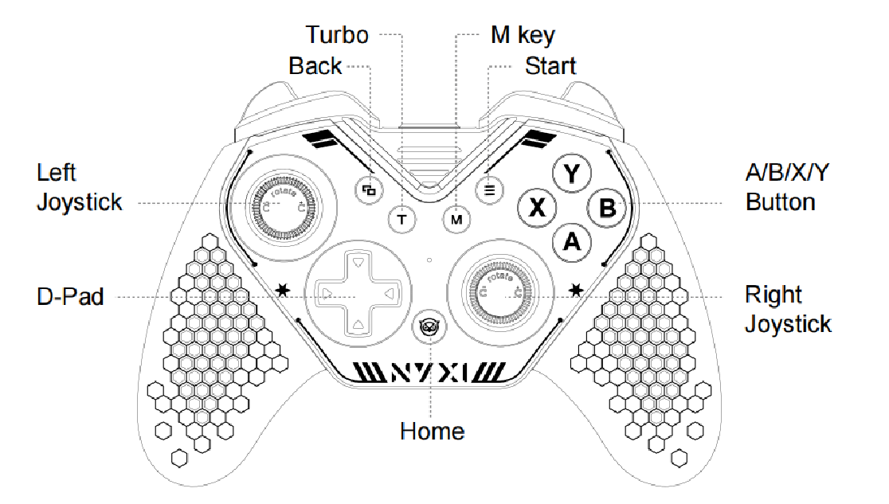

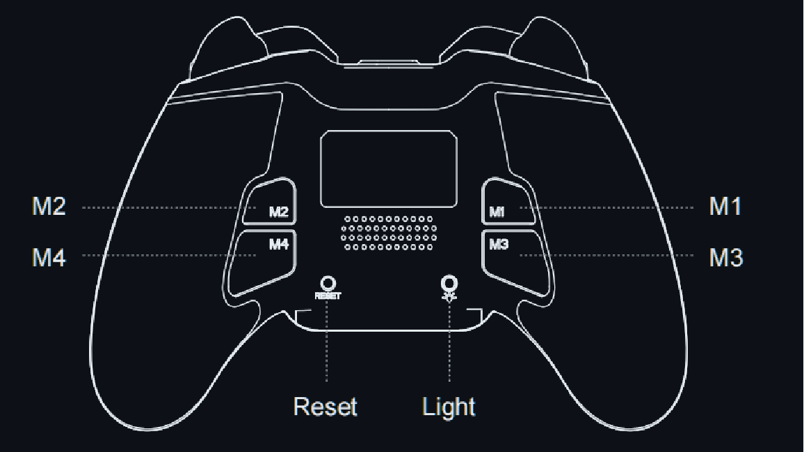

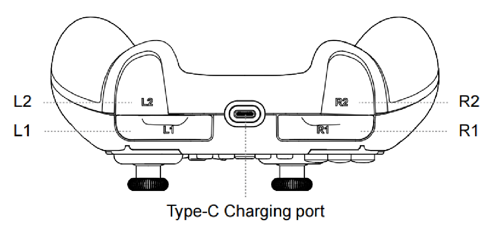

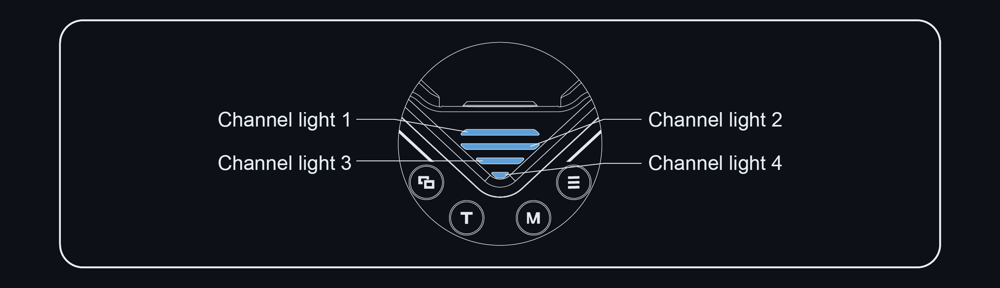

### USER GUIDE

#### PC

- **Receiver Mode**

Press and hold the **B + HOME buttons** simultaneously to turn on the controller. The Channel 1 LED will flash rapidly. Plug the receiver into your PC. Press and hold the button on the receiver for 3 seconds. Wait for the controller and receiver to pair successfully.

**Once connected**, the controller will operate in **Xinput mode**.

To switch to **Switch Pro mode**, press and hold the **BACK + START buttons** simultaneously for **3 seconds**.

To switch from **Switch Pro mode** to **Dinput mode**, press and hold the **BACK + START buttons** again for **3 seconds**.

To return to **Xinput mode** from **Dinput mode**, press and hold the **BACK + START buttons** for **3 seconds** once more.

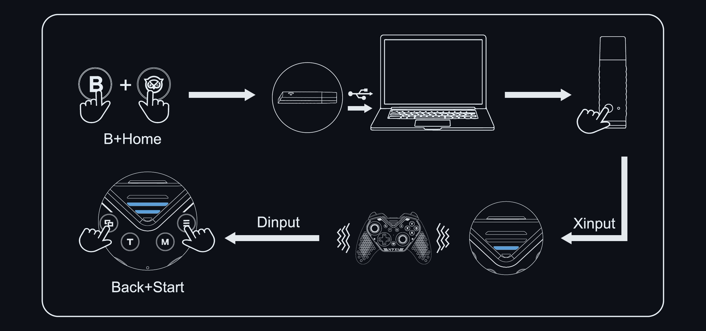

- **Wired Mode**

Use a **USB-C cable** to connect the controller to your PC. Once connected, the controller is ready for use.

To **switch modes,** press and hold the **BACK + START buttons**, following the **same logic** as when connecting via the receiver.

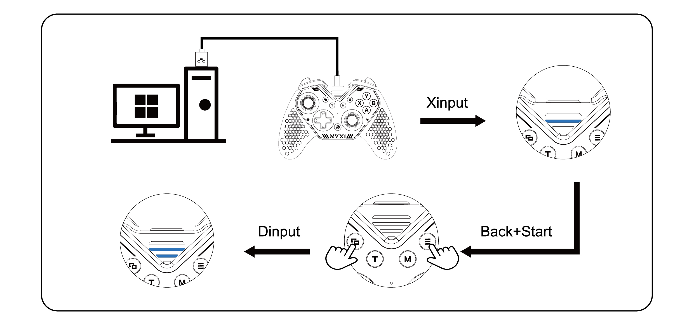

- **Bluetooth Mode**

Press and hold the **A + HOME buttons** simultaneously to turn on the controller. The **Channel 2 LED** will start flashing.

Search for ***Xbox Wireless Controller*** in the Bluetooth device list on your PC. Click **Connect** to complete the pairing process.

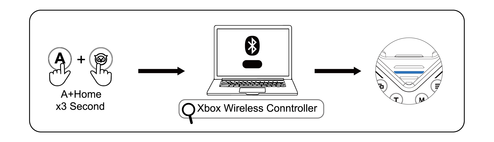

#### Switch

- **Wireless Mode**

Press and hold the **B + HOME buttons** simultaneously to turn on the controller.

Search for the controller on your Switch and wait for it to pair automatically.

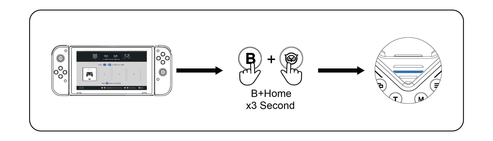

- **Wired Mode**

To connect the controller directly to the Switch via a wired connection, you will need a hub.

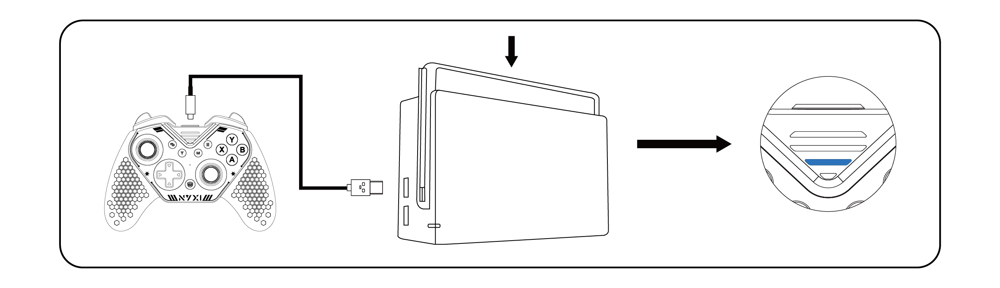

#### Android

Press and hold the **A + HOME buttons** simultaneously to turn on the controller. Search for ***Xbox Wireless Controller*** in the Bluetooth device list and click Connect to pair it with your phone.

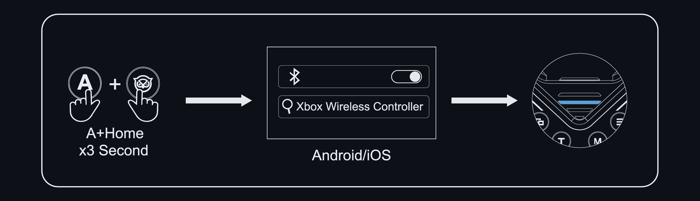

#### iOS

Press and hold the **A + HOME buttons** simultaneously to turn on the controller. Search for ***Xbox Wireless Controller*** in the Bluetooth device list and click Connect to pair it with your device.


#### Windows Handheld Device

Press and hold the **A + HOME buttons** simultaneously to turn on the controller. Search for ***Xbox Wireless Controller*** and click Connect to pair it with your device.


#### Tesla

- **Receiver Mode**

Press and hold the **B + HOME buttons** simultaneously to turn on the controller. Plug the receiver, keep pressing the button on the receiver and wait for the controller to automatically pair and connect.

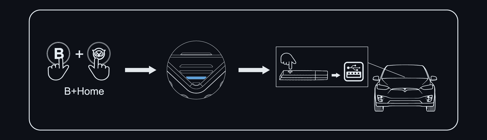

- **Wired Mode**

Simply connect the controller to the **Tesla** using a **USB cable**, and it will be ready to use.

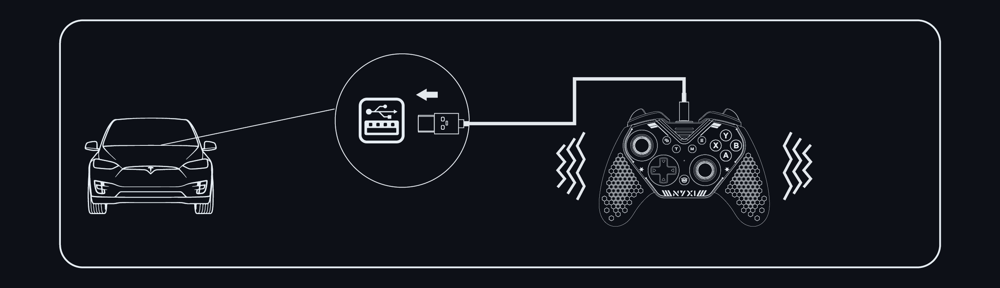

- **Bluetooth Mode**

Press and hold the A + HOME buttons simultaneously to turn on the controller. Search for Xbox Wireless Controller and click Connect to pair it with your Tesla.

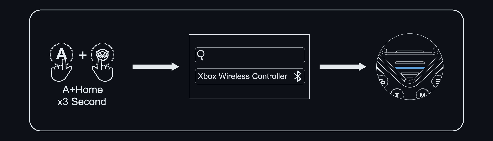

#### Android TV

Press and hold the **A + HOME buttons** simultaneously to turn on the controller. Search for ***Xbox Wireless Controller*** and click Connect to pair it with your TV.


### NYXI Flexi | Introduction

### ABXY Key Swap Operation

Take off the magnetic cover and gently remove the ABXY keycaps and swap their positions according to your preference. After swapping the keycaps, securely place the magnetic cover back in place to ensure the keycaps stay in place and avoid accidental detachment.

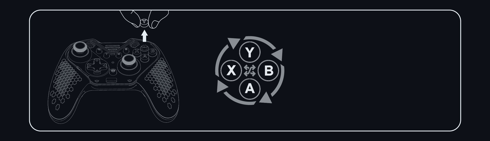

**Note:**

- Currently, only the **A and B buttons** can be swapped, as well as the **X and Y buttons**.
- The controller's mode setting will not be affected during the keycap swap.
- Be careful during the process to avoid losing the keycaps.

#### Left Joystick and D-pad Module Swap Operation

Take off the magnetic cover, and gently pull the left joystick and D-pad module upwards from their slots. Rotate them at 180° and press them down firmly into their new positions. Once the modules are in place, securely attach the magnetic cover to complete the swap.

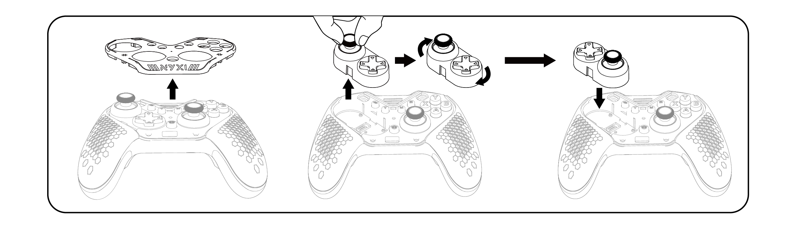

Note:

- This function supports **hot-swapping**, allowing you to change modules during gameplay. The controller will automatically adjust the data in real-time without issues like reversed direction.
- When installing, make sure to press the module down firmly to avoid poor contact, which could lead to data errors.
- Be careful to handle the module by its center when removing it, to avoid pulling the joystick and potentially damaging its lifespan and precision.
- Avoid tilting or flipping the controller during the module swap to prevent the ABXY keycaps from falling off or getting lost.

#### RGB Switching

Turn on the controller. Press the **RGB button on the back** of the controller to cycle through the following lighting effects:

Rainbow Cycle -- Rainbow Breathing -- Solid Red -- Red Breathing -- Solid Orange -- Orange Breathing -- Solid Yellow -- Yellow Breathing -- Solid Green -- Green Breathing -- Solid White -- White Breathing -- Solid Blue -- Blue Breathing -- Solid Purple -- Purple Breathing

The default lighting is **Solid Blue** when the controller is powered on. If the lighting is adjusted, when the controller restarts, it will automatically save the last used lighting mode.

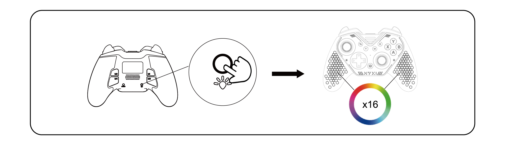

#### Programmable Button Function

\*Supported buttons for programmable function: **ABXY, L1, L2, R1, R2, D-pad, L3, R3, and the left/right joysticks**.

##### Recording:

Press and hold the **T button + the back button** you want to program. The controller will vibrate, and the **Channel four LEDs** will flash simultaneously, indicating that the recording process has started.

Once the recording is complete, press the **T button** to save the programmed setting. The controller can store up to **21 different key combinations**.

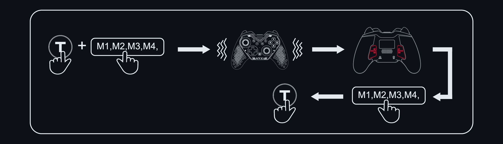

##### Clear the Mapping:

Press and hold the **set button + the back button** you want to clear. The controller will vibrate, and the **Channel four** LEDs will flash simultaneously, indicating that you are in clear mode.

Without entering any key combinations, press the **T button** to reset the back button to its default state.

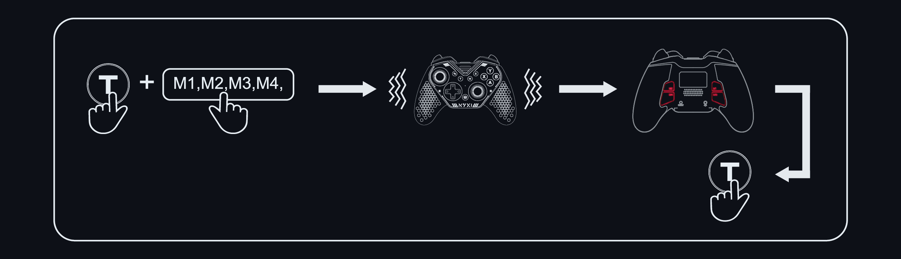

#### M Button Function

After powering on the controller, press and hold the **M button** for 3 seconds. The controller will vibrate, indicating that the **Back Button Function（M1/M2/M3/M4）** have been quickly disabled to prevent accidental activation.

Press and hold the **M button** for 3 seconds to enable the **Back Button Function（M1/M2/M3/M4）**again.

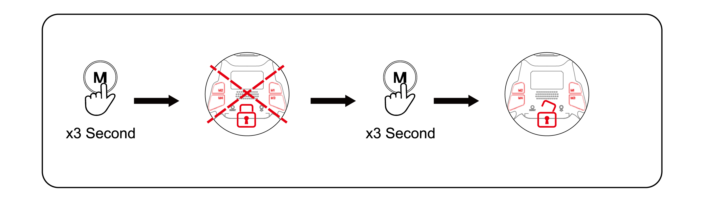

#### Reset Function

Turn on the controller. Press the **reset button on the back** to initiate the reset.

After the reset, all previously **configured key macros** and **turbo functions** will be cleared, and you will need to reconfigure them.

#### Turbo Function

\* Supported buttons for Turbo function: **ABXY, L1, R1, L2, R2,** and the **D-pad**.

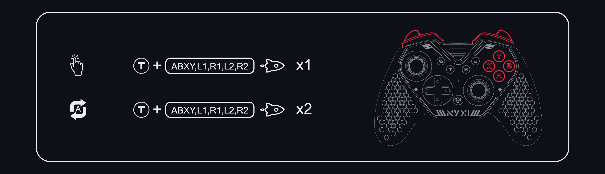

##### Manual Rapid Fire:

Press and hold the **set button** + the **action button**. The **channel LED** will flash twice quickly, and the controller will vibrate, indicating the setup is successful.

While holding the button, it will continue to rapidly fire. Release the button to stop the rapid fire.

##### Auto Rapid Fire:

Press the **set button** + the **same action button** again. The **channel LED** will flash rapidly, and the controller will vibrate, indicating the setup is successful.

The button will now **auto-repeat (rapid fire)** continuously. Pressing the button again will stop or restart the rapid fire.

##### Cancel Rapid Fire:

Press the **set button** + the **action button** for a third time to cancel the turbo function.

After setting up **turbo**, the **channel LED** will blink in sync with the rapid-fire frequency when triggered
<!-- manual:end -->
